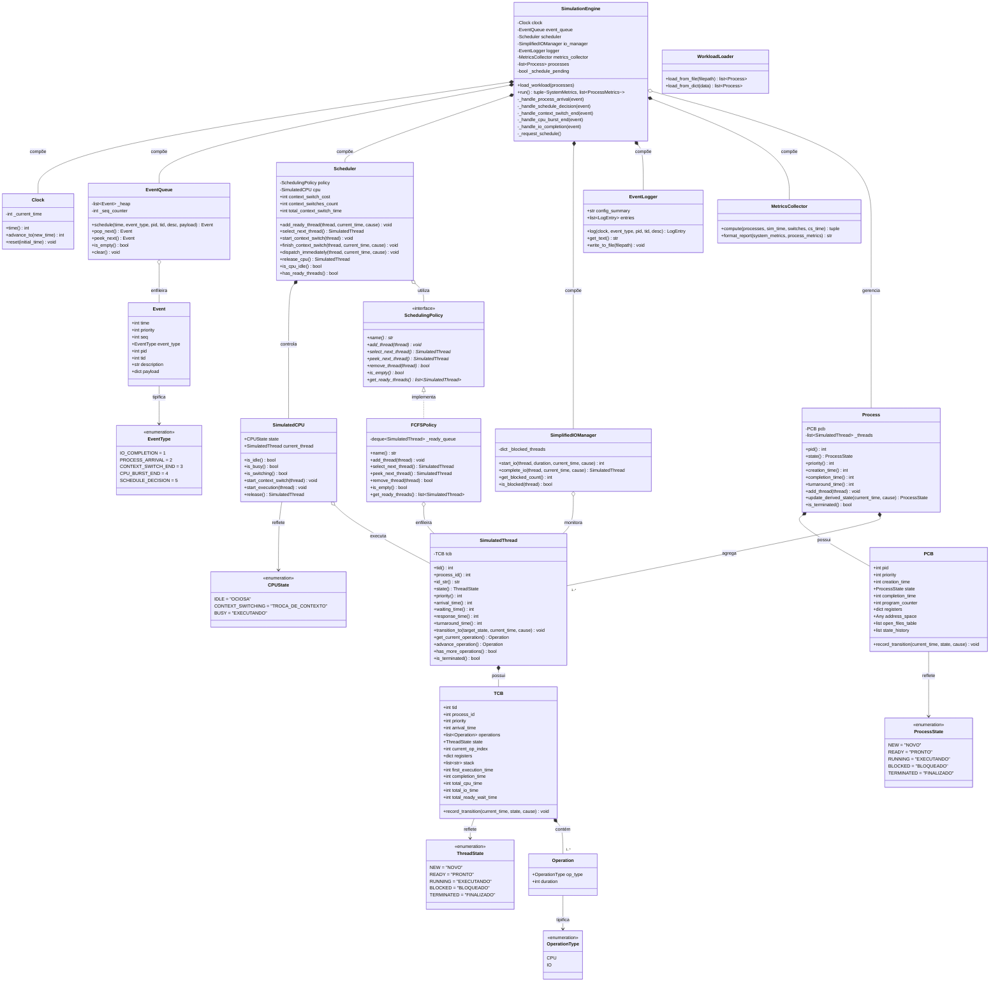

# Diagrama de Classes do Simulador de SO

**Disciplina de Sistemas Operacionais**  
**Prof. Maurício Acconcia Dias**

---

## 1. Diagrama de Classes Implementado (Primeira Entrega)

O diagrama abaixo representa com fidelidade as classes, atributos, métodos, composições, agregações e interfaces efetivamente implementadas na primeira entrega do projeto.



---

## 2. Diagrama de Classes Planejado para a Entrega Final

O diagrama a seguir descreve a **arquitetura planejada** que expandirá o simulador na Entrega Final, integrando as novas políticas de escalonamento, memória virtual paginada, subsistema completo de E/S com dispositivos independentes e sistema de arquivos hierárquico.

```mermaid
classDiagram
    direction TB

    %% Políticas de Escalonamento Adicionais
    class SchedulingPolicy {
        <<interface>>
        +select_next_thread()* SimulatedThread
        +add_thread(thread)* void
    }

    class FCFSPolicy {
        +select_next_thread() SimulatedThread
    }

    class RoundRobinPolicy {
        -int quantum
        -deque~SimulatedThread~ _ready_queue
        +select_next_thread() SimulatedThread
        +check_quantum_expiration(current_burst) bool
    }

    class PriorityPolicy {
        -bool is_preemptive
        -list~SimulatedThread~ _priority_queue
        +select_next_thread() SimulatedThread
        +apply_aging() void
    }

    SchedulingPolicy <|.. FCFSPolicy : implementa
    SchedulingPolicy <|.. RoundRobinPolicy : implementa (planejada)
    SchedulingPolicy <|.. PriorityPolicy : implementa (planejada)

    %% Subsistema de Memória Paginada
    class MemoryManager {
        -int page_size
        -int total_frames
        -list~Frame~ frames
        -PageReplacementPolicy replacement_policy
        +translate_address(process, logical_addr) int
        +handle_page_fault(process, page_number) Frame
    }

    class PageTable {
        -dict~int, PageTableEntry~ entries
        +is_present(page_num) bool
        +get_frame(page_num) int
        +map(page_num, frame_num) void
    }

    class PageReplacementPolicy {
        <<interface>>
        +select_victim(frames)* int
    }

    class FIFOReplacementPolicy {
        -deque~int~ frame_order
        +select_victim(frames) int
    }

    MemoryManager *-- PageReplacementPolicy : utiliza
    PageReplacementPolicy <|.. FIFOReplacementPolicy : implementa
    Process o-- PageTable : possui (via PCB)

    %% Subsistema de E/S e Dispositivos
    class DeviceManager {
        -dict~str, Device~ devices
        +request_io(device_id, thread, req_type, block_num) void
        +dispatch_device_queues() void
    }

    class Device {
        <<abstract>>
        +str device_id
        +int service_time
        +bool is_busy
        +DeviceQueue queue
        +process_next_request()* void
    }

    class BlockDevice {
        -int current_track
        -DiskSchedulingPolicy disk_scheduler
        +read_block(block_num) void
        +write_block(block_num) void
    }

    class CharacterDevice {
        +read_char() str
        +write_char(char) void
    }

    Device <|-- BlockDevice : herda
    Device <|-- CharacterDevice : herda
    DeviceManager *-- Device : gerencia

    %% Subsistema de Arquivos
    class FileSystem {
        -Directory root_directory
        -GlobalOpenFileTable global_open_table
        +create_file(path, permissions) FCB
        +open_file(process, path, mode) int
        +read_file(process, fd, bytes) bytes
        +write_file(process, fd, data) int
        +close_file(process, fd) void
    }

    class FCB {
        +str name
        +str file_type
        +int size_bytes
        +int permissions
        +list~int~ allocated_blocks
    }

    class GlobalOpenFileTable {
        -dict~int, OpenFileEntry~ open_files
        +register_open(fcb, mode) int
        +deregister_open(entry_id) void
    }

    FileSystem *-- GlobalOpenFileTable : coordena
    FileSystem o-- FCB : manipula
    Process o-- "open_files_table" : mapeia descritor local
```
